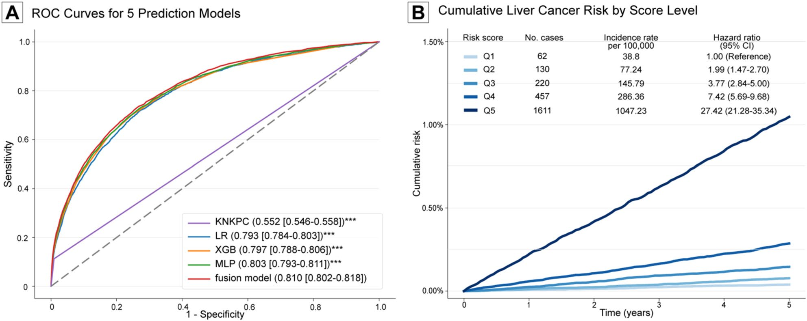

# [BMC Med Inform Decis Mak 2026] ShortSeq-CNN-MLP: Liver Cancer Risk Stratification Using Deep Learning on Nationwide Longitudinal Health Screening Data

<p align="center">
   📖 <a href="https://link.springer.com/article/10.1186/s12911-025-03323-x" target="_blank">Paper</a>&nbsp;&nbsp;&nbsp;&nbsp;💾 <a href="https://doi.org/10.5281/zenodo.24392754" target="_blank">Zenodo</a>
</p>

Liver cancer surveillance in Korea targets people with viral hepatitis or cirrhosis, even though the risk from metabolic and alcohol-related liver disease is rising. We developed **ShortSeq-CNN-MLP**, a fusion model that reads three biennial health screenings (2010–2015) with a one-dimensional convolutional neural network and static predictors with a multilayer perceptron, to predict 5-year liver cancer risk from routinely collected screening and insurance claims records. In a retrospective cohort of **3,962,209** adults aged 50–69 years from the Korean National Health Insurance Service, with 12,401 incident liver cancers, the model reached an AUROC of **0.810** (95% CI, 0.802–0.818) and a sensitivity of **0.736**, compared with **0.552** and **0.112** for the current national surveillance criteria. The highest-risk quintile accounted for **65%** of incident cases and had a **27-fold** higher hazard than the lowest. Using all three screening time points gave the best performance. The same code runs on other longitudinal EHR/EMR or claims tables with a few repeated visits.

<p align="center">
   
</p>

<br>
<br>

## Quick Start

Create a new virtual environment, e.g. with conda

```bash
~$ conda create -n shortseq python=3.10
```

Activate the environment:
```bash
~$ conda activate shortseq
```

Install the required packages:
```bash
~$ pip install -r requirements.txt
```

Prepare the data:
```bash
~$ mkdir -p ./data/raw
```

Place the NHIS tables in the ./data/raw directory (column list: [data/README.md](data/README.md)). Without NHIS access, create synthetic tables in the same layout:
```bash
~$ python scripts/make_toy_data.py
```

Your directory structure should look like this:
```
ShortSeq-CNN-MLP-NHIS/
├── data/
│   └── raw/
│       ├── target_cancer.csv
│       ├── target_g1eq.csv
│       ├── g1eq_total.csv
│       ├── target_cq.csv
│       └── t20/
│           ├── t20_2007.csv
│           └── ... (one file per year, to 2015)
├── configs/
├── liverrisk/
├── main.py
├── requirements.txt
└── README.md
```

<br>

## Dataset

The study used the Korean National Health Insurance Service (NHIS) database. The data cannot be shared; qualified researchers can apply at [https://nhiss.nhis.or.kr](https://nhiss.nhis.or.kr).

1) Health screening results and questionnaires, 2010–2015
2) Insurance claims with ICD-10 diagnosis codes, 2007–2015
3) Cancer diagnoses, insurance contribution and deaths, 2007–2020
4) Family history of cancer, 2010–2015

<br>

## Training and Evaluation

```bash
~$ python main.py --step {build, split, train, evaluate, explain, all} --model {lr, xgb, mlp, fusion, all} --window {t1, t2, t3, t1+t2, t2+t3, t1+t2+t3, all}
```

Run every step on the synthetic tables:
```bash
~$ python main.py --step all --window all --config configs/toy.yaml
```

Settings are in configs/default.yaml. To use your own EHR/EMR data, see [docs/own_data.md](docs/own_data.md).

<br>

## Main Results

<p align="center">
  
</p>

Differences between this code and the original analysis notebooks are listed in [docs/reproducibility.md](docs/reproducibility.md).

<br>

## Interpretability

<p align="center">
  
</p>
<br>

## Cite Us
If you find this repository useful in your research, please cite our work:

```bibtex
@article{choi2026liver,
      title={Liver cancer risk stratification using deep learning on nationwide longitudinal health screening data: a retrospective cohort study},
      author={Yewon Choi and Sungmin Cho and Changdai Gu and Chungho Kim and Bomi Park and Hwiyoung Kim},
      journal={BMC Medical Informatics and Decision Making},
      volume={26},
      pages={44},
      year={2026},
      doi={10.1186/s12911-025-03323-x}
}
```

## Contact
Yewon Choi ([Homepage](https://yeong22.github.io), [Google Scholar](https://scholar.google.com/citations?hl=en&user=DFJ7HgkAAAAJ))
