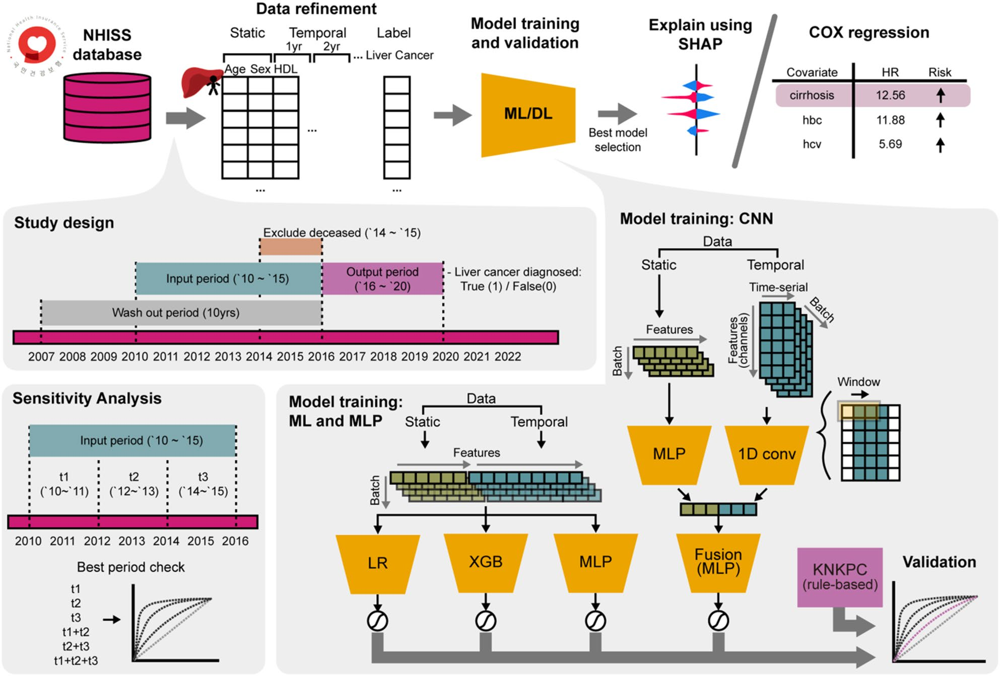
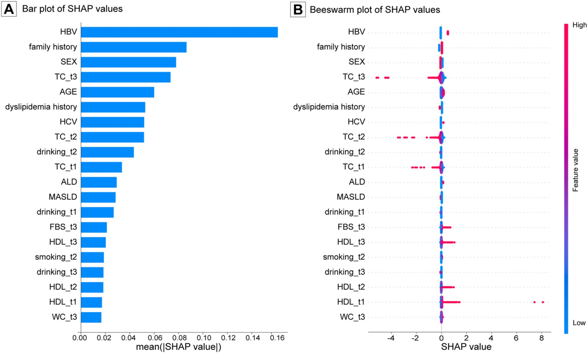

[BMC Med Inform Decis Mak 2026] ShortSeq-CNN-MLP: Liver Cancer Risk Prediction from Short Longitudinal Health Records
=====================================================================================================================

<p align="center">
  <a href="https://link.springer.com/article/10.1186/s12911-025-03323-x"></a>
  <a href="https://doi.org/10.1186/s12911-025-03323-x"></a>
  <a href="LICENSE"></a>
  
  
</p>

📄 [Paper](https://link.springer.com/article/10.1186/s12911-025-03323-x) &nbsp; 📑 [Supplementary](https://link.springer.com/article/10.1186/s12911-025-03323-x) (Additional file 1) &nbsp; 📌 [How to cite](#citation)

**ShortSeq-CNN-MLP** is the fusion model from our paper. A 1D CNN reads a short sequence of repeated measurements (three biennial health screenings, 2010–2015), an MLP reads static predictors, and the two are joined to predict **5-year liver cancer risk**. Trained on the longitudinal health screening and insurance claims records of **3,962,209** Korean adults aged 50–69 (National Health Insurance Service, NHIS), it reached an AUROC of **0.810** and a sensitivity of **0.736**, against **0.552** and **0.112** for the current Korean surveillance criteria (KNKPC). The highest-risk quintile held **65%** of incident liver cancers, with a **27-fold** hazard compared with the lowest. The same code runs on any patient-level table with a few repeated visits, such as EHR/EMR or claims data ([how](#use-it-on-your-own-ehr--emr-data)).

> 📌 **If this code or model helps your work, please cite:** Choi Y, Cho S, Gu C, Kim C, Park B, Kim H. Liver cancer risk stratification using deep learning on nationwide longitudinal health screening data: a retrospective cohort study. *BMC Medical Informatics and Decision Making* 2026;26:44. [doi:10.1186/s12911-025-03323-x](https://doi.org/10.1186/s12911-025-03323-x) ([BibTeX](#citation))

**Keywords:** electronic health records (EHR), electronic medical records (EMR), insurance claims, health screening, longitudinal data, short time series, liver cancer, hepatocellular carcinoma (HCC), cancer risk prediction, clinical prediction model, deep learning, 1D CNN, multimodal fusion, explainable AI (SHAP), Cox regression, Korea NHIS

<p align="center">
  <a href="imgs/workflow.jpg"></a><br>
  <em>Study workflow (Fig. 1 of the paper).</em>
</p>

## Quick Start

```bash
git clone https://github.com/yeong22/ShortSeq-CNN-MLP-NHIS.git
cd ShortSeq-CNN-MLP-NHIS
conda create -n shortseq python=3.10 -y
conda activate shortseq
pip install -r requirements.txt
```
Tested on macOS with Apple silicon (CPU and `--device mps`). On Linux or Windows with a GPU, install the PyTorch build for your CUDA version first ([pytorch.org](https://pytorch.org/get-started/locally/)). PyTorch 2.5.1 has no wheel for Intel Macs.

Run every step on **synthetic** data (about 3 minutes on a laptop CPU):
```bash
python scripts/make_toy_data.py
python main.py --step all --window all --config configs/toy.yaml
```
Results go to `outputs/toy/`. The synthetic tables carry a made-up risk signal, so their numbers say nothing about real liver cancer risk.

## Data

The study used the Korean National Health Insurance Service (NHIS) database, which cannot be shared. Qualified researchers can apply at [nhiss.nhis.or.kr](https://nhiss.nhis.or.kr/). Put the NHIS tables here:
```
data/raw/
├── target_cancer.csv     # demographics, insurance contribution, yearly cancer flags, death
├── target_g1eq.csv       # health screening results, self-reported history
├── g1eq_total.csv        # questionnaire (alcohol, exercise)
├── target_cq.csv         # family history of cancer
└── t20/t20_2007.csv ... t20_2015.csv   # claims with ICD-10 codes
```
Columns, coding and how each predictor is derived: [data/README.md](data/README.md).

## Usage

All settings (cohort years, ICD-10 codes, feature lists, hyperparameters) are in [configs/default.yaml](configs/default.yaml).

| Step | Command | What it does |
|---|---|---|
| 1 | `python main.py --step build` | NHIS tables → analytic cohort (`data/processed/cohort.csv`) and flowchart counts |
| 2 | `python main.py --step split` | 80/20 patient-level split, stratified by outcome, age decade and sex |
| 3 | `python main.py --step train --model all` | LR, XGBoost, MLP and the fusion model with the Table S4 hyperparameters |
| 4 | `python main.py --step evaluate` | AUROC / AUPRC / sensitivity / specificity with 95% CIs, DeLong tests, KNKPC rule, risk quintiles, calibration |
| 5 | `python main.py --step explain` | SHAP values for the fusion model |

Useful options:
```bash
python main.py --step train --model fusion --window t3           # one observation window
python main.py --step train --model all --window all --search    # Table S7: every window, each tuned separately
python main.py --step train --model fusion --device cuda:1       # or --device mps on Apple silicon
```
Windows: `t1` (2010–11), `t2` (2012–13), `t3` (2014–15), `t1+t2`, `t2+t3`, `t1+t2+t3` (main analysis). Without `--search`, every window uses the Table S4 values, which were tuned on the main window; `--search` starts from them.

## Use it on your own EHR / EMR data

The models need one row per patient. Put the table at `data/processed/cohort.csv` and start from `--step split`; the NHIS-specific build step is skipped.

| Column | Example | Notes |
|---|---|---|
| `id` | `P0001` | patient identifier |
| outcome | `outcome` = 0 / 1 | event in the prediction window; name it in `label_column` |
| static predictors | `age`, `sex`, `diabetes` | listed in `features.static_continuous` and `features.static_binary` |
| repeated predictors | `sbp_t1`, `sbp_t2`, `sbp_t3` | `<variable>_<time point>`; variables in `features.temporal_continuous` / `temporal_ordinal`, time points in `cohort.periods` |
| `fu_years` (optional) | `4.2` | follow-up time; enables Kaplan–Meier and Cox by risk quintile |

Copy `configs/default.yaml` to `configs/mydata.yaml` and edit these keys:
```yaml
label_column: outcome
cohort:
  periods: {t1: [], t2: [], t3: []}     # names of your time points (oldest first); the years are not used
features:
  temporal_continuous: [sbp, hba1c, egfr]
  temporal_ordinal: [smoking]
  static_continuous: [age]
  static_binary: [sex, diabetes]
  windows: {full: [t1, t2, t3]}
  main_window: full
split:
  stratify_on: [outcome, sex]
evaluate:
  knkpc_markers: []                     # the KNKPC baseline is specific to liver cancer
```
```bash
python main.py --config configs/mydata.yaml --step split
python main.py --config configs/mydata.yaml --step train --model all --search
python main.py --config configs/mydata.yaml --step evaluate
python main.py --config configs/mydata.yaml --step explain
```

## Models

| Model | Input | Class imbalance |
|---|---|---|
| KNKPC | rule: flagged if HBV, HCV or cirrhosis (2022 KLCA–NCC surveillance targets) | – |
| LR | all predictors as one vector | balanced class weights |
| XGBoost | all predictors as one vector | `scale_pos_weight` searched over 1 and n_neg/n_pos; 1 selected (unweighted) |
| MLP | all predictors as one vector | asymmetric focal loss |
| **Fusion (ShortSeq-CNN-MLP)** | static predictors → MLP; repeated predictors (10 variables × time points) → 1D CNN with residual blocks; concatenated → MLP classifier | asymmetric focal loss |

Static predictors (15): age, sex, history of stroke, heart disease, hypertension, diabetes, dyslipidemia, HBV, HCV, ALD, MASLD, cryptogenic liver disease, cirrhosis, family history of liver and other cancers.
Repeated predictors (10 per screening period): BMI, hemoglobin, fasting glucose, waist circumference, total cholesterol, HDL cholesterol, alcohol, physical activity, smoking, household income.

All models are fit on 80% of the training set. The other 20% is used for early stopping (validation loss), the hyperparameter search and the Youden cutoff. The test set is never used for fitting, early stopping, tuning or the cutoff.

## Main Results

Test set, main window t1+t2+t3, as reported in the paper (Table S7; n = 792,442, 2,480 cases).

| Model | AUROC (95% CI) | AUPRC (95% CI) | Sensitivity (95% CI) | Specificity (95% CI) |
|---|---|---|---|---|
| KNKPC | 0.552 (0.545–0.558) | 0.007 (0.006–0.008) | 0.113 (0.099–0.125) | 0.991 (0.991–0.991) |
| LR | 0.793 (0.784–0.803) | 0.022 (0.019–0.024) | 0.721 (0.704–0.739) | 0.727 (0.726–0.728) |
| XGBoost | 0.797 (0.788–0.806) | 0.025 (0.022–0.029) | 0.701 (0.684–0.719) | 0.753 (0.752–0.754) |
| MLP | 0.803 (0.793–0.811) | 0.028 (0.024–0.032) | 0.727 (0.710–0.744) | 0.731 (0.730–0.732) |
| **Fusion** | **0.810 (0.802–0.818)** | **0.029 (0.026–0.034)** | **0.736 (0.720–0.753)** | 0.732 (0.731–0.733) |

All AUROC differences from the fusion model: P < 0.001 (DeLong). The abstract and Results text give KNKPC as AUROC 0.552 (0.546–0.558) and sensitivity 0.112 (0.100–0.125).

<p align="center">
  <a href="imgs/performance.jpg"></a><br>
  <em>(A) ROC curves. (B) 5-year cumulative liver cancer risk by predicted-risk quintile (Fig. 2 of the paper).</em>
</p>

| Risk quintile | Cases | Incidence per 100,000 (crude) | Hazard ratio (95% CI) |
|---|---|---|---|
| Q1 | 62 | 38.8 | 1.00 (reference) |
| Q2 | 130 | 77.2 | 1.99 (1.47–2.70) |
| Q3 | 220 | 145.8 | 3.77 (2.84–5.00) |
| Q4 | 457 | 286.4 | 7.42 (5.69–9.68) |
| Q5 | 1,611 | 1,047.2 | 27.42 (21.28–35.34) |

## Sensitivity Analysis: Observation Windows

AUROC on the test set by which screening periods the models see (Table S7; each window tuned separately).

| Window | LR | XGBoost | MLP | Fusion |
|---|---|---|---|---|
| t1 | 0.758 | 0.767 | 0.785 | 0.784 |
| t2 | 0.761 | 0.765 | 0.792 | 0.792 |
| t3 | 0.765 | 0.768 | 0.796 | 0.794 |
| t1+t2 | 0.776 | 0.782 | 0.797 | 0.800 |
| t2+t3 | 0.785 | 0.793 | 0.803 | 0.808 |
| **t1+t2+t3** | 0.793 | 0.797 | 0.803 | **0.810** |

Using all three screenings works best, and the most recent single screening (t3) beats the earlier ones.

## Interpretability

<p align="center">
  <a href="imgs/shap.jpg"></a><br>
  <em>Mean |SHAP| and beeswarm plot for the fusion model (Fig. 3 of the paper).</em>
</p>

HBV, family history of liver cancer, sex and total cholesterol at t3 contribute most. The Cox models for Table 2 and Table S8 are in [stats/table1_cox.sas](stats/table1_cox.sas) (SAS 9.4; reads `cohort.csv` from the build step).

## Notes on Reproducibility

Data preparation follows the original analysis notebooks, so the cohort and predictors match the published models; training and evaluation follow the paper's Methods. A run on the NHIS data may therefore not match every published number.

| Topic | Original notebooks | This code |
|---|---|---|
| Train/test split | best of five seeds, chosen by LR test AUROC | one seeded stratified split |
| Early stopping | fusion monitored the test set (≤300 epochs, last-epoch weights kept); the MLP ran all 200 epochs | validation split, ≤100 epochs, best-epoch weights (Methods S2) |
| Final fit | refit on the full training set after the search | 80% of the training set; 20% for early stopping, search and cutoff |
| Hyperparameter search | one 80/20 split per window (the paper says five-fold CV) | Table S4 values for every window; `--search` tunes each window on the 20% split |
| LR/XGBoost window features | the five shorter windows indexed columns by position in a differently ordered table | selected by name; those five Table S7 rows may not reproduce (main window unaffected) |
| Value per screening period | first exam of the interval (the paper says the most recent) | first exam; `cohort.period_value: last` follows the paper |
| Alcohol and activity classes | cut-offs <1, <2, <4 (Table S3 words them as ≤1, ≤2, ≤4) | notebook cut-offs; the SAS Cox covariates use Table S3's |
| ICD-10 code lists | Table S2 prints a few codes differently; MASLD includes I10 | notebook lists |
| Household income | contribution levels 10 and 16 unassigned (treated as missing) | same; Table S1's missing counts suggest the published cohort may have kept them |
| Complete cases | also required some non-model columns (e.g. a stomach-cancer screening result) | model predictors only, so the cohort can be slightly larger |
| Follow-up | 2016–2020, as in Fig. 1 (the text says to 2021) | 2016–2020 |
| Risk quintiles | groups of unequal size; crude cases per 100,000 | equal-size quintiles; crude and Kaplan–Meier incidence |
| 95% CIs | method not stated in the paper | percentile bootstrap |
| SHAP | DeepExplainer treated SiLU layers as plain gradients (approximate) | exact rescale rule for SiLU (`explain.silu_rule: gradient` restores the original) |
| Calibration | not in the paper; a later notebook fit and scored it on the test set | fit on validation, scored on test |
| Fine-Gray (Table S9) | SAS, not released | not included |

## Repository Structure
```
├── main.py                  # one entry point: --step build | split | train | evaluate | explain | all
├── configs/
│   ├── default.yaml         # every study setting
│   └── toy.yaml             # small, fast settings for the synthetic data
├── liverrisk/
│   ├── cohort.py            # inclusion/exclusion, outcome, predictors, ICD-10 history
│   ├── split.py             # stratified patient-level split
│   ├── features.py          # observation windows, scaling and encoding (Methods S1)
│   ├── models.py            # MLP, residual 1D CNN, fusion model (Methods S2)
│   ├── losses.py            # asymmetric focal loss
│   ├── train.py             # training, early stopping, group-wise search
│   ├── evaluate.py          # CIs, DeLong, KNKPC, risk quintiles, calibration
│   └── explain.py           # SHAP
├── stats/table1_cox.sas     # Table 1, person-years, Cox models, VIF
├── scripts/make_toy_data.py # synthetic NHIS-like tables
├── data/README.md           # data access and column definitions
├── imgs/                    # figures from the paper
├── CITATION.cff             # GitHub "Cite this repository"
└── LICENSE                  # Apache-2.0
```

## Citation

If you use this code or the ShortSeq-CNN-MLP model, please cite the paper. GitHub's **Cite this repository** button gives the same reference.
```bibtex
@article{choi2026liver,
  title   = {Liver cancer risk stratification using deep learning on nationwide longitudinal health screening data: a retrospective cohort study},
  author  = {Choi, Yewon and Cho, Sungmin and Gu, Changdai and Kim, Chungho and Park, Bomi and Kim, Hwiyoung},
  journal = {BMC Medical Informatics and Decision Making},
  volume  = {26},
  pages   = {44},
  year    = {2026},
  doi     = {10.1186/s12911-025-03323-x}
}
```

## Funding
National R&D Program for Cancer Control, Ministry of Health and Welfare, Republic of Korea (HA23C0083); Technology Innovation Program (RS-2025-02220286), Ministry of Trade, Industry & Resources, Korea.

## Contact
Yewon Choi. For questions about the code, please open an issue.

## License
Code: [Apache License 2.0](LICENSE). Figures in `imgs/` are from the paper, © The Author(s), licensed under [CC BY-NC-ND 4.0](https://creativecommons.org/licenses/by-nc-nd/4.0/).
